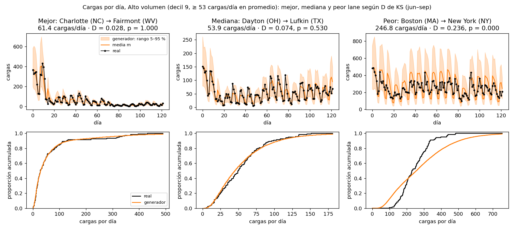
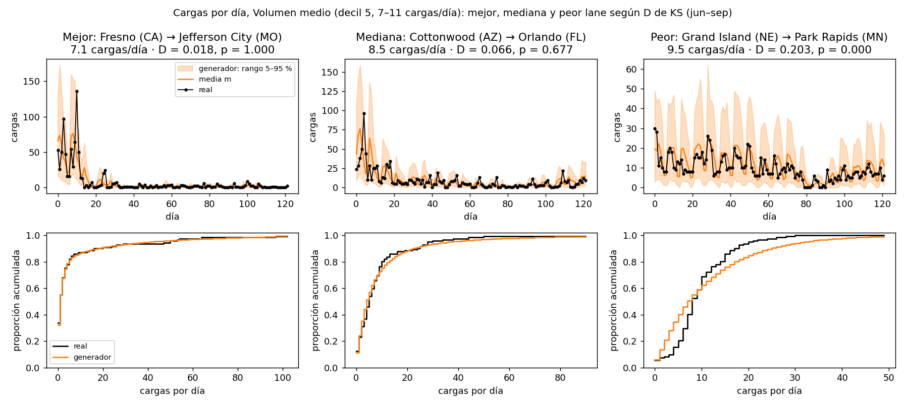
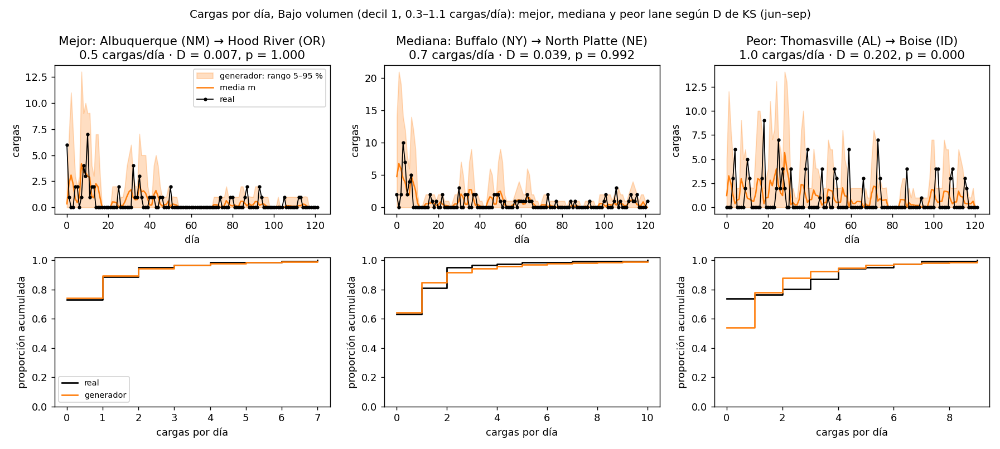
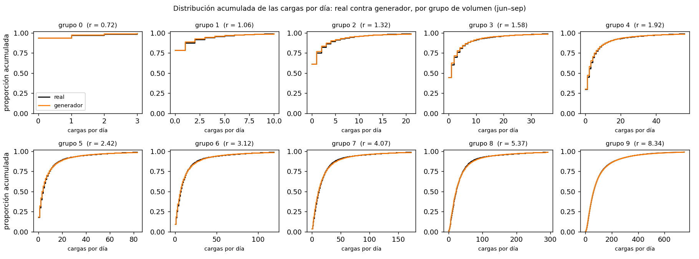
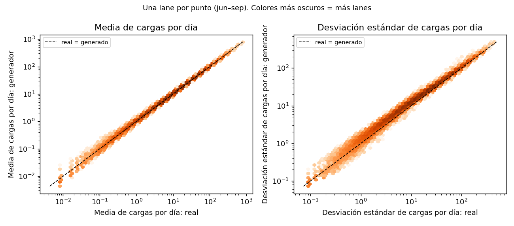
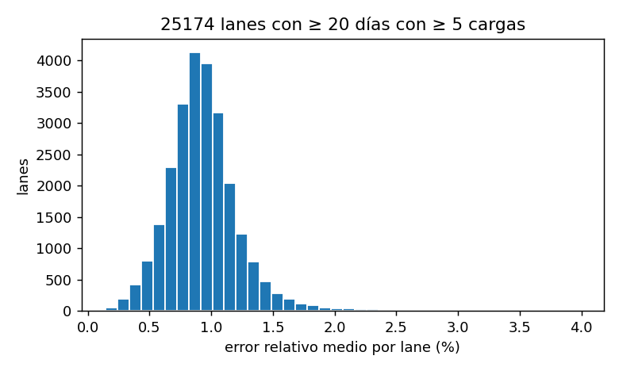
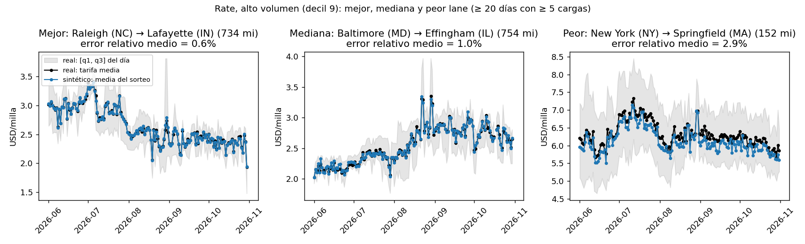
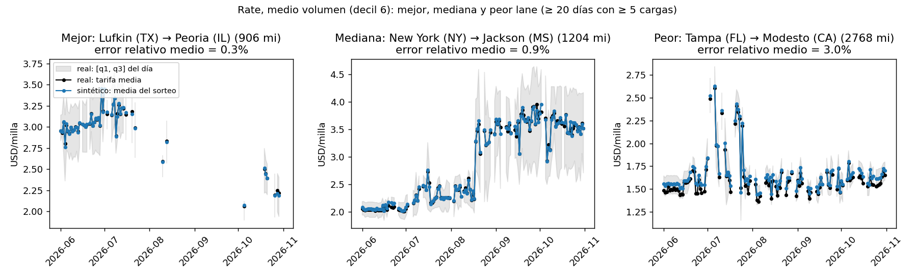
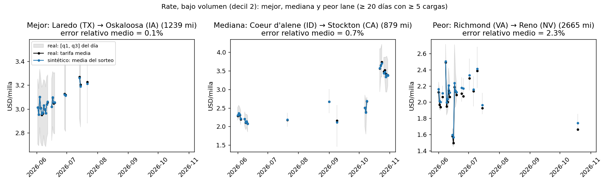
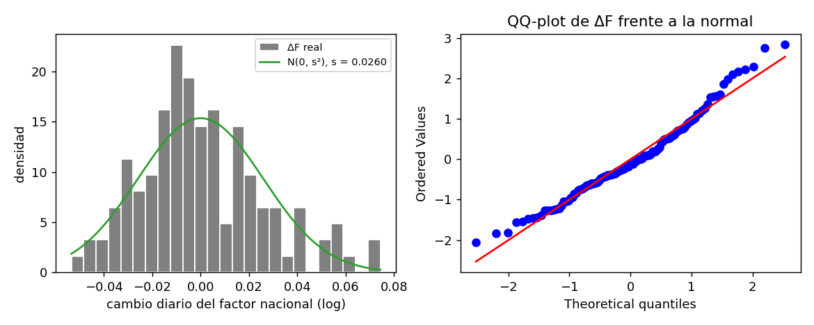

# Validación del generador de datos del mercado

## 1. Qué se valida y cómo se lee este documento

El generador (`metodologia_realizaciones_mercado_reefer.md`) crea realizaciones aleatorias de cada día real del mercado a partir de la serie original. Sus tres fuentes de aleatoriedad son:

| Pieza del generador | Qué se sortea | Cómo se valida aquí |
| --- | --- | --- |
| Disponibilidad de cargas | Número de cargas por lane y día: binomial negativa (Poisson si la media es menor que 1) | Prueba de **Kolmogorov-Smirnov** (sección 2) |
| Rate ($/milla) | Precio de cada carga, por inversión de los 6 cuantiles del día | **Mejores, medianos y peores casos** (sección 3) |
| Nivel nacional δ | Corrimiento normal, fijo en el episodio | Normalidad de la variación diaria real (sección 4) |

**Criterio general.** Se compara lo que produce el modelo con los datos reales, con la prueba que corresponde a cada pieza. Esta es la validación operacional que describe Sargent (2013): comprobar que la salida del modelo tiene la exactitud suficiente para su uso previsto. Un generador no es "exacto"; hay que decir qué tan cerca queda y dónde falla. Por eso el documento reporta también los casos malos.

**Datos.** Los 194 hubs y las 37,442 lanes. Cada lane va de un hub a otro hub; en tablas y figuras se nombra cada hub con su ciudad y estado, según `hubs_id.xlsx`, por ejemplo "Boston (MA)". Entrenamiento es jun–sep 2026 (122 días); prueba es octubre 2026 (31 días), que el generador nunca usó para estimar `r` ni los factores semanales. Todo se reproduce con `python validar_generador_datos.py`. Las tablas y figuras quedan en `results/market_validation/validacion_metodologia/`.

### Resumen

| Pieza | Resultado | Lectura |
| --- | --- | --- |
| Cargas (binomial negativa), por lane | KS rechaza el 2.6 % de las 37,442 lanes al 5 % de significancia (jun–sep) y el 0.7 % en octubre | En el 97.4 % de las lanes (jun–sep), el KS no detecta diferencia entre la distribución de cargas real y la que genera el modelo (sección 2.7) |
| Cargas, errores por lane (sección 2.6) | Días sin cargas: 34.05 % real, 34.16 % generado. Media: error mediano 4.8 %. Desviación: el generador queda 17 % por encima de la real | Nivel y proporción de ceros bien reproducidos. Los datos generados son algo más variables que los reales |
| Cargas, por grupo de volumen | D entre 0.005 y 0.026 (jun–sep); entre 0.003 y 0.043 (octubre) | Las curvas acumuladas real y generada casi se superponen |
| Rate | Error relativo medio de la media: 0.97 %. En el 99 % de las lanes es menor que 1.9 % | Muy buen ajuste. Peor caso: 4.0 %. El sesgo del peor caso es positivo en 7 de 8 niveles de volumen (sección 3) |
| δ | Escala y centro correctos. Normalidad rechazada al 5 % por poco (p = 0.034) | La variación real tiene una ligera cola a la derecha (sección 4) |

---

## 2. Disponibilidad de cargas: prueba de Kolmogorov-Smirnov

### 2.1 Qué se compara

Para cada lane, el generador sortea el número de cargas de cada día con una binomial negativa de media `m` y dispersión `r` (Paso 4b). La pregunta es sencilla: **¿las cargas por día que se observaron en la lane se distribuyen igual que las que sortea el generador?**

La prueba de Kolmogorov-Smirnov (KS) responde esto comparando las dos **distribuciones acumuladas**. Su estadístico, **D**, es la mayor distancia vertical entre las dos curvas. Se lee directamente: D = 0.05 significa que, en el peor punto, la proporción de días con "x cargas o menos" difiere en 5 puntos porcentuales entre lo real y lo generado.

**Hipótesis.** H0: las cargas reales de la lane y las del generador tienen la misma distribución. Se rechaza H0 con un nivel de significancia del 5 % cuando el p-valor es menor que 0.05. Si H0 fuera cierta en todas las lanes, se rechazaría alrededor del 5 % por azar.

### 2.2 Procedimiento

Para cada lane:

1. **Muestra real:** las cargas observadas en cada día (122 días en jun–sep).
2. **Muestra generada:** para cada día, 20 sorteos del generador, con la media `m` de ese día y la `r` del grupo de volumen de la lane (binomial negativa si `m ≥ 1`, Poisson si `m < 1`). Son 2,440 valores por lane. `m` se calcula como en el generador: promedio de los 3 días anteriores y 3 posteriores, sin el propio día, ajustado por día de la semana.
3. **KS de dos muestras** entre ambas (`scipy.stats.ks_2samp`; Massey, 1951).

Se prueban **todas las lanes: las 37,442**, sin filtros de mínimo de datos, en jun–sep y también en octubre (que no se usó para estimar `r`). Una lane que no tuvo ninguna carga en el período (402 lanes en jun–sep) da D = 0 y p = 1, porque tanto lo real como lo generado son solo ceros.

**Nota sobre datos discretos.** El KS está pensado para variables continuas. Con conteos, los p-valores salen algo más altos de lo que corresponde, es decir, la prueba rechaza menos de lo nominal (Conover, 1972). Por eso un 2.6 % de rechazos es coherente con un buen ajuste, pero no demuestra por sí solo que sea exacto: hay que mirar también D y las curvas.

### 2.3 Resultado por lane

| Período | Lanes probadas | Rechazadas al 5 % | D mediano | D percentil 90 | D crítico al 5 % |
| --- | --- | --- | --- | --- | --- |
| jun–sep (122 días) | 37,442 | **2.6 %** | 0.056 | 0.100 | 0.126 |
| octubre (31 días) | 37,442 | **0.7 %** | 0.100 | 0.174 | 0.250 |

- El D mediano (0.056) queda por debajo del valor crítico (0.126): la mayoría de las lanes pasa con holgura.
- En octubre cada lane tiene solo 31 días y la prueba detecta solo desvíos grandes, por eso su D crítico es el doble. El 0.7 % indica que no se detectaron fallas, no que el ajuste sea mejor que en jun–sep.
- Rechazos por grupo de volumen (jun–sep), de menor a mayor volumen (grupos 0 a 9): 0.0 %, 0.1 %, 1.4 %, 2.8 %, 3.6 %, 3.4 %, 3.0 %, 3.8 %, 3.2 % y 5.1 %. En las lanes de poco volumen (grupos 0 y 1) casi todos los días son ceros y la prueba tiene muy poca capacidad de detectar diferencias; ahí el porcentaje bajo no prueba un mejor ajuste. Ningún grupo supera el 5.1 %.

### 2.4 Mejores, medianos y peores casos, por nivel de volumen

La prueba usa las 37,442 lanes. Para dibujar casos hay que elegir lanes, y se hace **dentro de cada nivel de volumen**: se divide el conjunto en 10 grupos (deciles) según sus cargas por día, y en cada grupo se ordenan las lanes por D (la mayor distancia entre las dos curvas acumuladas) y se toman la **mejor**, la **mediana** y la **peor**. Así se ve el ajuste en lanes de mucho volumen, de volumen medio y de poco volumen, y no solo en un extremo.

Una sola lista de "mejores" no sirve: las de menor D globales son lanes de 0.5 a 1.5 cargas por día, donde casi todos los días valen 0 o 1 y es fácil que las curvas coincidan. Por eso se muestran los tres niveles y se indica en cada caso las cargas por día.

Para dibujar se excluyen, dentro de cada nivel, las lanes con menos de 30 días con cargas (una lane vacía tiene D = 0 y saldría "mejor" sin mostrar nada). Quedan 30,088 de las 37,442 lanes; el decil 0 (el de menor volumen) casi no tiene lanes con tantos días con cargas (solo 1 de 3,745) y por eso no se dibuja. El KS de la sección 2.3 sí usa todas las lanes.

**D de la mejor, mediana y peor lane en cada nivel de volumen (jun–sep).** El decil 1 es el de menor volumen que se puede dibujar, y el 9 el de mayor volumen:

| Decil de volumen | Cargas por día (rango) | D mejor | D mediana | D peor |
| --- | --- | --- | --- | --- |
| 1 | 0.3 – 1.1 | 0.007 | 0.039 | 0.202 |
| 2 | 1.1 – 2.4 | 0.009 | 0.047 | 0.231 |
| 3 | 2.4 – 4.5 | 0.013 | 0.054 | 0.192 |
| 4 | 4.5 – 7.2 | 0.014 | 0.060 | 0.225 |
| 5 | 7.2 – 11.3 | 0.018 | 0.066 | 0.203 |
| 6 | 11.3 – 17.5 | 0.017 | 0.068 | 0.192 |
| 7 | 17.5 – 28.3 | 0.023 | 0.071 | 0.182 |
| 8 | 28.3 – 52.8 | 0.023 | 0.073 | 0.198 |
| 9 | 52.8 – 781 | 0.028 | 0.074 | 0.236 |

La lane mediana de todos los niveles tiene D entre 0.04 y 0.07 y pasa la prueba. Las peores son el extremo de la cola (alrededor de 0.2) y es el mismo rango en todos los niveles de volumen.

En las figuras, la fila superior muestra las cargas reales por día (negro) contra la media `m` (naranja) y el rango 5–95 % de lo que genera el modelo (banda naranja). La fila inferior muestra lo que compara el KS: la distribución acumulada real (negro) contra la del generador (naranja).

#### Alto volumen (decil 9)

| Caso | Lane | Cargas por día | D | p-valor |
| --- | --- | --- | --- | --- |
| Mejor | Charlotte (NC) → Fairmont (WV) | 61.4 | 0.028 | 1.000 |
| Mediana | Dayton (OH) → Lufkin (TX) | 53.9 | 0.074 | 0.530 |
| Peor | Boston (MA) → New York (NY) | 246.8 | 0.236 | < 0.001 |

- **Mejor y mediana:** con unas 55–60 cargas por día, las dos curvas acumuladas casi se superponen, y la serie real queda dentro de la banda del generador. Muestran que el buen ajuste no se limita a lanes casi vacías.
- **Peor (Boston (MA) → New York (NY)):** con unas 250 cargas por día y un patrón semanal marcado, las cargas reales varían menos que lo que genera el modelo (la curva real es más empinada y la banda naranja es más ancha que la dispersión real). El KS lo rechaza.

#### Volumen medio (decil 5)

| Caso | Lane | Cargas por día | D | p-valor |
| --- | --- | --- | --- | --- |
| Mejor | Fresno (CA) → Jefferson City (MO) | 7.1 | 0.018 | 1.000 |
| Mediana | Cottonwood (AZ) → Orlando (FL) | 8.5 | 0.066 | 0.677 |
| Peor | Grand Island (NE) → Park Rapids (MN) | 9.5 | 0.203 | < 0.001 |

- **Mejor y mediana:** las curvas coinciden, incluida la proporción de días con pocas cargas.
- **Peor (Grand Island (NE) → Park Rapids (MN)):** otra vez el generador es más disperso que lo real: da más días con pocas cargas y más con muchas, mientras que las cargas reales se concentran entre 5 y 20 por día.

#### Bajo volumen (decil 1)

| Caso | Lane | Cargas por día | D | p-valor |
| --- | --- | --- | --- | --- |
| Mejor | Albuquerque (NM) → Hood River (OR) | 0.5 | 0.007 | 1.000 |
| Mediana | Buffalo (NY) → North Platte (NE) | 0.7 | 0.039 | 0.992 |
| Peor | Thomasville (AL) → Boise (ID) | 1.0 | 0.202 | < 0.001 |

- **Mejor y mediana:** son lanes en que casi todos los días valen 0, 1 o 2, así que la curva acumulada tiene pocos escalones y coincidir es más fácil. Se muestran para completar el cuadro, no como evidencia fuerte. La evidencia está en los niveles de volumen alto y medio.
- **Peor (Thomasville (AL) → Boise (ID)):** el 74 % de los días reales no tiene cargas y el generador da cerca del 54 %. Lo real tiene más días vacíos y rachas de pocos días con muchas cargas, y el modelo las reparte de forma más pareja.

**Lectura conjunta.** En los casos buenos y medianos el generador reproduce la distribución real a cualquier volumen. En los peores casos el patrón se repite: **el modelo es más variable que lo real** en las lanes de volumen alto y medio (más dispersión), y en la de bajo volumen da menos días vacíos de los que hay. Esto es consistente con lo que aparece en la sección 2.6 (la desviación generada queda en promedio 17 % sobre la real). Estas tres lanes son el extremo del 2.6 % de lanes en que el KS detecta una diferencia.

### 2.5 Resultado por grupo de volumen

Las lanes se agrupan en los 10 grupos de volumen con los que se estimó `r`. Para cada grupo se compararon todas sus cargas reales contra un sorteo del generador por lane-día. Con unas 457,000 observaciones por grupo, el KS rechaza H0 con cualquier diferencia mínima, así que aquí se reporta D, no el p-valor.

| Grupo de volumen | r | D (jun–sep) | D (octubre) |
| --- | --- | --- | --- |
| 0 (menor volumen) | 0.72 | 0.005 | 0.003 |
| 1 | 1.06 | 0.013 | 0.010 |
| 2 | 1.32 | 0.019 | 0.022 |
| 3 | 1.58 | 0.023 | 0.037 |
| 4 | 1.92 | 0.026 | 0.043 |
| 5 | 2.42 | 0.028 | 0.040 |
| 6 | 3.12 | 0.024 | 0.031 |
| 7 | 4.07 | 0.021 | 0.030 |
| 8 | 5.37 | 0.017 | 0.027 |
| 9 (mayor volumen) | 8.34 | 0.007 | 0.018 |

El desvío máximo entre la distribución real y la generada es de 0.3 a 4.3 puntos porcentuales. En octubre, fuera de muestra, es algo mayor en los grupos medios pero sigue siendo pequeño.

### 2.6 Métricas de error de las cargas

Además del KS, se mide cuánto se parece lo generado a lo real en tres cantidades por lane: la **media** de cargas por día, la **desviación estándar** (qué tan variable es la lane) y la **proporción de días sin cargas**. Los valores del generador se calculan de forma exacta a partir de `m` y `r`, sin sorteos. El error relativo es `(generado − real) / real`. Se reporta la mediana del valor absoluto, el percentil 90 y el sesgo (mediana con signo; positivo = el generador da más que lo real). Las lanes sin cargas (402) no tienen error relativo (el real es cero) y solo entran en el error ponderado.

**Referencia de ruido de muestreo.** Con 122 días por lane, la media y la desviación reales tienen ruido propio, así que ni un modelo exacto daría error cero. Para saber cuánto error es "normal", se calculó la misma métrica sobre datos simulados por el propio generador. Si el error real se parece al de la referencia, el modelo está al nivel del ruido.

**jun–sep (37,442 lanes):**

| Cantidad | Real | Generado | Error mediano (referencia) | Error percentil 90 (referencia) | Sesgo mediano (referencia) |
| --- | --- | --- | --- | --- | --- |
| Media de cargas por lane-día | 20.33 | 20.66 | 4.8 % (7.2 %) | 16.6 % (27.4 %) | +1.7 % (+0.4 %) |
| Desviación estándar | — | — | 18.2 % (13.5 %) | 46.2 % (43.0 %) | **+17.3 %** (+4.4 %) |
| Días sin cargas | 34.05 % | 34.16 % | 1.24 pp (1.06 pp) | 4.9 pp (4.1 pp) | — |

El error de la media ponderado por el volumen de cada lane es 3.9 % (referencia: 5.1 %).

**octubre (37,442 lanes, 31 días cada una):**

| Cantidad | Real | Generado | Error mediano (referencia) | Sesgo mediano (referencia) |
| --- | --- | --- | --- | --- |
| Media de cargas por lane-día | 10.77 | 10.49 | 7.6 % (10.9 %) | −4.1 % (+0.5 %) |
| Desviación estándar | — | — | 17.0 % (16.7 %) | +9.2 % (+6.7 %) |
| Días sin cargas | 37.22 % | 38.10 % | 1.84 pp (1.99 pp) | — |

Cómo leerlo:

- **Días sin cargas: coincide.** 34.05 % real contra 34.16 % generado, y la diferencia por lane (1.24 pp) está al nivel del ruido de la referencia (1.06 pp).
- **Media: coincide, pero en gran parte por construcción.** El error (3.9 % ponderado, 4.8 % mediano) es menor que el ruido de la referencia, porque `m` se calcula con las propias cargas reales de la lane: su promedio sigue al real casi por construcción. No es evidencia independiente. En octubre la media generada queda 2.6 % por debajo de la real y el sesgo mediano es −4.1 %, cuando con datos exactos del modelo sería +0.5 %; hay un leve subestimado. No se investigó la causa.
- **Desviación: el generador es más variable que lo real.** En la lane mediana, la desviación generada es 17 % mayor que la real. Unos 4 puntos de eso son ruido de muestreo (una desviación calculada con 122 días de datos asimétricos tiende a quedar baja); los otros ~13 puntos son una diferencia real. Es decir, los datos generados oscilan algo más que los reales. Una posible explicación, que no se probó: `m` es el promedio de 6 días reales vecinos y ya trae el ruido de esos días, y el generador le suma encima el ruido de la binomial negativa. Es la limitación del Paso 4b que la metodología ya declara. En octubre la diferencia es menor (+9.2 % contra +6.7 % de la referencia).

### 2.7 Qué dice y qué no dice esta prueba

**Cómo redactar el resultado.** La afirmación que la prueba respalda es:

> En el 97.4 % de las lanes (jun–sep), el KS no detecta, al 5 % de significancia, diferencia entre la distribución de cargas diarias observada y la que genera el modelo.

No respalda decir que "las cargas siguen una binomial negativa", por cuatro razones:

- **No rechazar no es demostrar.** Si el modelo fuera exacto, se esperaría que cerca del 95 % de las lanes no se rechazara. El 97.4 % es coherente con un buen ajuste, pero no significa que el 97.4 % de las lanes "siga" la binomial negativa.
- **Parte del 97.4 % no aporta información.** Las 402 lanes sin cargas (1.1 %) pasan de forma trivial, y en los grupos 0 y 1 (20 % de las lanes) casi todos los días son ceros, así que la prueba apenas puede rechazar. En los grupos 2 a 9, que sí tienen datos, el rechazo va de 1.4 % a 5.1 % (promedio cercano a 3.3 %), es decir, también cerca del 97 % no se rechaza.
- **Se compara contra el generador, no contra una binomial negativa fija.** La media `m` cambia cada día, la `r` es por grupo de volumen y las lanes con `m < 1` usan Poisson. Lo que se valida es que ese conjunto reproduce la distribución observada.
- **El KS con conteos rechaza menos de lo nominal** (Conover, 1972), lo que sube el porcentaje de no rechazos.

Para el uso que se le da (generar muchos datos parecidos a los reales), esto es suficiente: el generador reproduce la distribución observada de cargas de la lane, con la salvedad de que genera días algo más variables que los reales (sección 2.6). Por último, la prueba no evalúa si el modelo acierta el número de cargas de un día concreto: esa es una pregunta distinta y esta prueba no la responde. La fila superior de la figura de la sección 2.4 (cargas reales contra la media `m`) solo permite verla de forma visual.

---

## 3. Rate: mejores, medianos y peores casos

### 3.1 Por qué no hay prueba de Kolmogorov-Smirnov para el rate

El KS necesita una **muestra** de precios individuales para compararla con una distribución. Los archivos diarios solo traen, por lane y día, seis cuantiles (min, q1, q2, q3, p90, max) y la media; no traen el precio de cada carga. Además, el generador sortea el precio **invirtiendo esos mismos seis cuantiles** (método de la inversa, Devroye, 1986), así que los cuantiles se reproducen por construcción y compararlos no prueba nada.

### 3.2 Qué sí se puede comparar

La **media diaria real** (`mean`) es un dato que el generador **no usa** para construir sus sorteos. Si la distribución lineal por tramos que se arma con los seis cuantiles es razonable, su media debe quedar cerca de la media real.

La media del precio sorteado se calcula **exacta**, sin Monte Carlo. Cada tramo entre cuantiles aporta su masa por su punto medio:

$$
\bar p = 0.25\,\tfrac{\min+q_1}{2} + 0.25\,\tfrac{q_1+q_2}{2} + 0.25\,\tfrac{q_2+q_3}{2} + 0.15\,\tfrac{q_3+p_{90}}{2} + 0.10\,\tfrac{p_{90}+\max}{2}
$$

Se verificó contra 400,000 sorteos del generador: 1.97234 (exacta) contra 1.97287 (Monte Carlo).

**Medida de error:** error relativo `(media sorteada − media real) / media real`, por lane-día. Por lane se reporta su promedio en valor absoluto (el MAPE de Hyndman y Koehler, 2006, aplicable aquí porque el rate siempre es positivo) y su sesgo (promedio con signo).

**Filtro: lane-días con al menos 5 cargas.** Con pocas cargas, los seis cuantiles son las propias cargas y el error sale cercano a cero sin que eso diga nada del modelo (con una sola carga los seis coinciden). El 35 % de los lane-días tiene menos de 5 cargas y el 13 % exactamente 1. En una primera corrida, sin filtro, las "mejores" lanes salieron con 1–2 cargas por día; por eso se fijó el filtro. Las lanes se comparan con al menos 20 días que cumplan el filtro.

### 3.3 Resultado global

| Lane-días incluidos | Cantidad | Sesgo | Error relativo medio | Mediana del error | Percentil 95 del error |
| --- | --- | --- | --- | --- | --- |
| Todos con cargas | 3,741,179 | +0.12 % | 0.94 % | 0.67 % | 2.76 % |
| Con ≥ 5 cargas | 2,442,306 | +0.03 % | 0.97 % | 0.71 % | 2.78 % |

Por lane (25,174 lanes con ≥ 20 días con ≥ 5 cargas), el error relativo medio es:

| Percentil | 5 | 25 | 50 | 75 | 90 | 95 | 99 |
| --- | --- | --- | --- | --- | --- | --- | --- |
| Error (%) | 0.51 | 0.76 | 0.91 | 1.08 | 1.27 | 1.42 | 1.90 |

El 99 % de las lanes tiene un error medio menor que 1.9 %. La media sorteada está, en promedio, a menos de 1 % de la media real.

### 3.4 Mejores, medianos y peores casos, por nivel de volumen

Igual que con las cargas, los casos se eligen **dentro de cada nivel de volumen** (decil de cargas por día): en cada uno se ordenan las lanes por su error relativo medio y se toman la mejor, la mediana y la peor. Así se ve el ajuste en lanes de mucho volumen, de volumen medio y de poco volumen. Solo entran lanes con al menos 20 días con 5 o más cargas (sección 3.2): 25,174 lanes. El decil 0 y casi todo el decil 1 no cumplen el filtro (3 lanes en el decil 1), así que el nivel más bajo que se puede dibujar es el decil 2.

**Error relativo medio de la mejor, mediana y peor lane en cada nivel de volumen:**

| Decil de volumen | Lanes | Mejor | Mediana | Peor |
| --- | --- | --- | --- | --- |
| 2 | 595 | 0.14 % | 0.70 % | 2.33 % |
| 3 | 2,621 | 0.16 % | 0.74 % | 3.29 % |
| 4 | 3,387 | 0.21 % | 0.81 % | 3.99 % |
| 5 | 3,627 | 0.24 % | 0.85 % | 3.69 % |
| 6 | 3,712 | 0.32 % | 0.90 % | 2.96 % |
| 7 | 3,740 | 0.39 % | 0.96 % | 3.22 % |
| 8 | 3,744 | 0.45 % | 0.98 % | 2.89 % |
| 9 | 3,745 | 0.55 % | 0.99 % | 2.93 % |

Las gráficas muestran la tarifa media real (negro), la media del sorteo (azul) y el rango real [q1, q3] del día (gris). Solo se dibujan los días que cumplen el filtro de 5 cargas; los demás quedan como huecos.

#### Alto volumen (decil 9)

| Caso | Lane | Distancia (mi) | Cargas por día | Días | Error relativo medio | Sesgo |
| --- | --- | --- | --- | --- | --- | --- |
| Mejor | Raleigh (NC) → Lafayette (IN) | 734 | 70.7 | 152 | 0.55 % | −0.04 % |
| Mediana | Baltimore (MD) → Effingham (IL) | 754 | 50.1 | 151 | 0.99 % | +0.01 % |
| Peor | New York (NY) → Springfield (MA) | 152 | 546.6 | 153 | 2.93 % | −2.91 % |

#### Volumen medio (decil 6)

| Caso | Lane | Distancia (mi) | Cargas por día | Días | Error relativo medio | Sesgo |
| --- | --- | --- | --- | --- | --- | --- |
| Mejor | Lufkin (TX) → Peoria (IL) | 906 | 9.8 | 51 | 0.32 % | −0.06 % |
| Mediana | New York (NY) → Jackson (MS) | 1,204 | 14.7 | 130 | 0.90 % | +0.35 % |
| Peor | Tampa (FL) → Modesto (CA) | 2,768 | 12.8 | 114 | 2.96 % | +2.88 % |

#### Bajo volumen (decil 2)

| Caso | Lane | Distancia (mi) | Cargas por día | Días | Error relativo medio | Sesgo |
| --- | --- | --- | --- | --- | --- | --- |
| Mejor | Laredo (TX) → Oskaloosa (IA) | 1,239 | 1.5 | 20 | 0.14 % | −0.02 % |
| Mediana | Coeur d'alene (ID) → Stockton (CA) | 879 | 1.8 | 22 | 0.70 % | −0.18 % |
| Peor | Richmond (VA) → Reno (NV) | 2,665 | 2.1 | 21 | 2.33 % | +2.33 % |

Cómo leerlos:

- **Alto y medio volumen:** la media sorteada sigue la media real día a día. Con 50 a 150 días comparados por lane, el error de la mejor lane es de 0.3 a 0.6 % y el de la mediana, de 0.9 a 1.0 %. En el nivel alto el mejor caso (0.55 %) tiene 152 días y 70 cargas por día, no es un resultado de pocas cargas.
- **Bajo volumen:** son lanes con pocos días que cumplen el filtro (20 a 22). Se muestran por completitud, pero 20 días con 5 cargas o más es poca evidencia por lane. Lo que sustenta la conclusión son los niveles altos.
- **Peores casos:** el error de la peor lane de cada nivel está entre 2.3 % y 4.0 %. En 7 de los 8 niveles el sesgo es positivo y casi igual al error: el precio sorteado queda sistemáticamente por encima del real. Esto concuerda con la debilidad que la metodología ya declara: entre p90 y max solo hay dos puntos y se interpola en línea recta, lo que sobrestima la media cuando la cola real es más corta. Con estos datos no se puede comprobar directamente, porque faltan los precios individuales. La excepción es New York (NY) → Springfield (MA) (decil 9), con sesgo negativo: es una lane muy corta (152 mi), con un nivel de tarifa alto (cerca de 6 USD/milla) y un volumen muy alto (547 cargas por día); no se investigó la causa.
- La peor lane de todas, entre las 25,174, es Ann Arbor (MI) → West Wendover (NV) (decil 4), con 3.99 %.

### 3.5 Conclusión de la sección

La media de los precios sorteados queda a menos de 1 % de la real en la lane típica y a menos de 4 % en la peor de 25,174. Lo que no se puede validar con estos datos es la forma de la distribución dentro del día, más allá de la media y los seis cuantiles.

---

## 4. Corrimiento de nivel δ

El generador sortea δ ~ Normal(0, s²), con `s` = desviación estándar del cambio diario del factor nacional ΔF (Paso 3). Aquí el KS sí aplica, porque ΔF es una muestra continua de 121 días. Como media y desviación se estiman de los mismos datos, se usa la versión de **Lilliefors (1967)**, con el p-valor obtenido por simulación (20,000 muestras normales).

| Estadístico | Valor |
| --- | --- |
| Media de ΔF (el generador supone 0) | 0.0004 (p = 0.86 contra 0) |
| Desviación de ΔF / `s` usada | 0.02608 / 0.02597 |
| Asimetría / curtosis en exceso | 0.57 / 0.18 |
| Lilliefors: D / p-valor | 0.084 / 0.034 |

La media y la escala coinciden. La normalidad se rechaza al 5 % por poco: ΔF tiene una asimetría positiva moderada (0.57), es decir, más subidas fuertes que bajadas fuertes, y δ simétrica no las reproduce. El efecto es pequeño (s ≈ 2.6 % del nivel de precios) y δ solo desplaza el nivel de todo el episodio.

---

## 5. Qué se puede afirmar

1. **Cargas.** En el 97.4 % de las 37,442 lanes (jun–sep) el KS no detecta diferencia entre la distribución de cargas real y la que genera el modelo (binomial negativa, o Poisson si `m < 1`); en octubre, en el 99.3 %. Esto muestra que el generador reproduce la distribución observada, no que las cargas "sigan" una binomial negativa (sección 2.7). Por grupo de volumen, D ≤ 0.043 (también fuera de muestra, en octubre). Las lanes con peor ajuste son casos aislados: una lane de muy alto volumen con patrón semanal marcado y otra de pocas cargas con más días vacíos de lo que genera el modelo. En las métricas de error (sección 2.6), el nivel de cargas y la proporción de días sin cargas coinciden con lo real, pero el generador es más variable: su desviación queda 17 % por encima de la real en la lane mediana (unos 13 puntos más allá del ruido de muestreo).
2. **Rate.** La media del precio sorteado reproduce la media real con error menor que 1 % en la lane típica y menor que 4 % en la peor.
3. **δ.** Escala y centro correctos, con una cola derecha leve que la normal no captura.
4. **Lo que no se valida.** La aceptación de cargas (el competidor y κ) no tiene datos reales de cargas ganadas y perdidas; es un supuesto, y se cubre con la sensibilidad a κ ∈ {0.5, 1, 2} (`validate_pricing.py`).

## Referencias

- Conover, W. J. (1972). A Kolmogorov goodness-of-fit test for discontinuous distributions. *Journal of the American Statistical Association*, 67(339), 591–596.
- Devroye, L. (1986). *Non-Uniform Random Variate Generation*. Springer-Verlag. Cap. II, sección 2.
- Hyndman, R. J. y Koehler, A. B. (2006). Another look at measures of forecast accuracy. *International Journal of Forecasting*, 22(4), 679–688. [doi:10.1016/j.ijforecast.2006.03.001](https://doi.org/10.1016/j.ijforecast.2006.03.001)
- Lilliefors, H. W. (1967). On the Kolmogorov-Smirnov test for normality with mean and variance unknown. *Journal of the American Statistical Association*, 62(318), 399–402.
- Massey, F. J. (1951). The Kolmogorov-Smirnov test for goodness of fit. *Journal of the American Statistical Association*, 46(253), 68–78. [doi:10.2307/2280095](https://doi.org/10.2307/2280095)
- Massey, F. J. (1951). The distribution of the maximum deviation between two sample cumulative step functions. *Annals of Mathematical Statistics*, 22(1), 125–128. (Versión de dos muestras.)
- Sargent, R. G. (2013). Verification and validation of simulation models. *Journal of Simulation*, 7(1), 12–24. [doi:10.1057/jos.2012.20](https://doi.org/10.1057/jos.2012.20)
